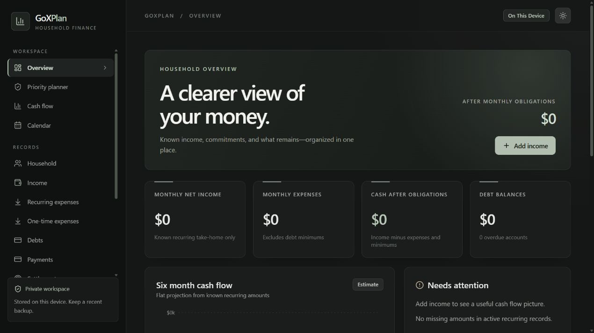

# GoXPlan

GoXPlan is a local-first household finance dashboard and Tauri 2 desktop app for Windows. The desktop app stores records in SQLite on the current machine. There is no backend, account, or cloud sync.



## Run locally

Requires Node.js 22 or newer. For the Windows desktop build, install Rust with the MSVC toolchain, Microsoft C++ Build Tools with Desktop development with C++, and WebView2.

```bash
npm install
npm run dev
```

The Vite URL is a temporary UI preview and can export records from the old browser IndexedDB origin. New records persist in the Windows desktop app. To launch SQLite:

```bash
npm run desktop:dev
```

To check a release build and create a Windows installer:

```bash
npm run lint
npm test
npm run build
npm run desktop:build
```

The installer is written under `src-tauri/target/release/bundle/nsis/`. SQLite is stored in Tauri's per-user application configuration directory under `com.goxplan.desktop` (within AppData on Windows). Native SQLite snapshots are in its `backups` subdirectory. The desktop app works offline. The browser preview uses transient memory; the old IndexedDB adapter is loaded only for explicit legacy export or migration.

## Features

- Dashboard: monthly recurring take-home, expenses, debt minimums, remaining cash, known debt balances, overdue count, missing-data warnings, and a cash-flow projection.
- Local SQLite CRUD for household profile, members, income sources and deposits, expenses and payments, debts, settlements, bank accounts and transfers, categories, monthly budgets, savings goals, trading activity, and saved forecast scenarios.
- Variable weekly pay: hourly, salaried, and variable sources; editable hourly rate; actual regular and overtime hours; configurable overtime multiplier; estimated gross; Thursday confirmation prompt; separate work period, confirmation, and deposit dates; actual gross, deductions, and net deposit; correction audit; weekly and monthly history. Paychecks are created only after confirmation.
- Debts include balance, APR, monthly minimum, status, due date, days late, security, settlement offer, collection agency, notes, owner reference, duplicate-original reference, and an edit history.
- Priority planner protects housing, utilities, food, transport, and legal obligations before debt minimums and optional settlements. Debt scores explain secured, legal, delinquency, collection, APR, fee, utilization, settlement, and user-urgency factors. Manual overrides remain editable.
- Payment calendar, interactive 12-month cash-flow forecast, payoff simulator, installment settlement schedules, one-time expenses, three-month emergency-fund target, and home savings goals with a VA readiness checklist and credit milestone.
- Trading records separate realized profit, payouts actually received, fees, tax reserves, drawdown, funded balance, and hypothetical projections. Aggregate trading figures are never automatically added to household recurring income. Enter dated trading withdrawals as payout transactions for the cash-flow forecast; do not also add them as income sources.
- Versioned JSON merge/export with record counts and conflict preview, skip/update/review policies, optional password-encrypted JSON backup (AES-GCM with PBKDF2), native SQLite snapshots and verified merge restore, separate CSV tables, multi-sheet XLSX, and browser print summary. Every record carries a confirmed, estimated, or unverified label.
- Responsive full-width navigation and content, search, editable forms, empty states, and light/dark themes.

### Confirm a variable paycheck

1. In **Income sources**, add an hourly or variable source and enter the current hourly rate if known. No hours or paycheck amount is assumed.
2. On Thursday, open **Income received** from the dashboard reminder. Enter the actual work period, regular and overtime hours, overtime multiplier, gross pay, deductions, net deposit, confirmation date, and deposit date. The gross estimate is informational only.
3. Select **Confirm paycheck** after the deposit amount is known. A source and work period can be confirmed only once. Use **Correct** on an existing paycheck to change it; enter a correction reason. Previous values remain in the SQLite audit table and JSON/XLSX export.

Changing the source's hourly rate does not change confirmed paycheck snapshots. Missed paychecks are flagged without creating fictitious deposits.

## Financial conventions

Weekly pay uses `weekly × 52 ÷ 12`, rounded to cents, when a fixed weekly amount is explicitly entered. Biweekly, semimonthly, and annual values use their corresponding monthly equivalents. Hourly and variable sources are excluded from fixed monthly income, even when a reference amount exists. The baseline cash simulator uses confirmed net deposits and actual withdrawn trading payouts; estimated salaried income and hypothetical trading appear only in a separate scenario. Its available settlement budget uses confirmed cash after the editable minimum cash reserve, even when a hypothetical scenario is displayed. Forecasts are planning estimates, not bank balances. Legacy bank records with only an undated balance remain unreconciled; enter a dated statement balance before treating later transactions as a running ledger.

Debt balance is a stock, monthly minimum is a scheduled obligation, and payment records represent actual cash paid. A collection record can point to its original debt ID; linked duplicates are grouped only after the relationship is verified. Closed and charged-off accounts with positive balances remain liabilities. Joint debt is one debt record and is counted once. Transfers and credit-card payment records are excluded from the `actualCashPaid` calculation to avoid counting them again on top of categorized spending. The dashboard's fixed-income projection uses scheduled expenses and minimums. Dated trading withdrawals enter the 12-month simulator only in their received month; hypothetical trading income remains a separate scenario.

Unknown amounts remain blank. The sample records appear **only** after choosing **Add example records** on the Data & backup screen and confirming. They contain the supplied $780 weekly take-home reference, $25 hourly rate, rent, electricity, Santander minimum, and three Topstep accounts with unknown balance and payout. The sample adds no paycheck transactions or other invented debt values.

## Privacy and backups

The desktop SQLite database stays on this machine, but **SQLite is not encrypted at rest**. Anyone with access to your Windows profile or disk may be able to read it. Native SQLite snapshots and plain JSON, CSV, and XLSX exports are also unencrypted. The optional password applies to JSON backups only; the password is never stored, exported, or recoverable. Keep backups somewhere you control. Import validates version 1, 2, and 3 JSON backups, previews conflicts, and applies the selected policy inside one database transaction without deleting existing records. No password fields exist in the data schema.

### Move IndexedDB data to SQLite

1. Open the old web version in the **same browser profile and origin** that contains your IndexedDB records.
2. In **Data & backup**, export a complete JSON backup (optionally encrypted). Keep that file.
3. Open the Tauri desktop app. In **Data & backup**, select that file, enter its password if needed, and choose **Import backup**.
4. Review the records in the desktop app and create a SQLite snapshot. The old IndexedDB data and source backup are not deleted.

If the desktop WebView itself contains old GoXPlan IndexedDB records, **Check and migrate this WebView** can merge those directly after confirmation. The desktop WebView cannot read another browser's origin. See [storage architecture](docs/storage.md) for the migration and future PostgreSQL plan.

The VA checklist is a planning aid and makes no eligibility, rate, or approval promise. Confirm current requirements with the VA and a lender.

## Project structure

- `src/lib/schema.ts`: versioned Zod model.
- `src/lib/storage.ts`: database access port; desktop selects SQLite and browser preview selects transient memory.
- `src/lib/sqliteStorage.ts`: Tauri SQL plugin adapter with integer-cent conversion, UUID merge, and correction audit.
- `src/lib/legacyIndexedDb.ts`: isolated legacy browser adapter retained for migration.
- `src-tauri/migrations/`: versioned normalized SQLite schema.
- `src/lib/finance.ts`, `src/lib/planning.ts`, `src/lib/paychecks.ts`: financial calculations and paycheck history.
- `src/lib/export.ts`: JSON, encrypted JSON, CSV, and XLSX.
- `src/App.tsx`: dashboard and editors.
- `src/lib/*.test.ts`: calculations and export coverage.

Generated backups and `dist/` are gitignored. Do not commit personal financial records.
